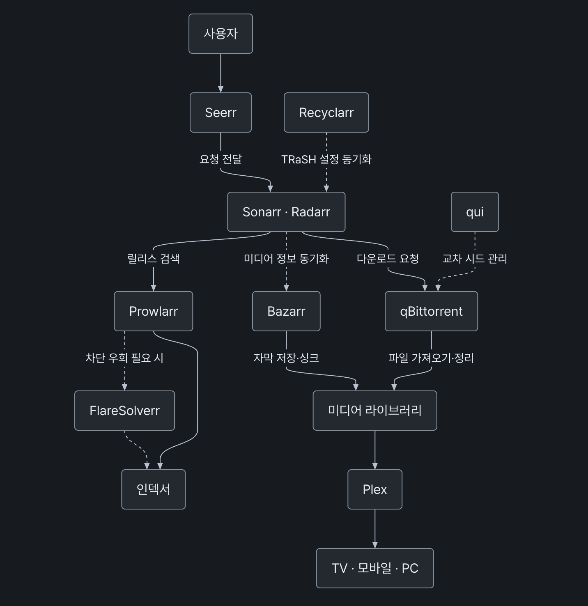

# mermaid



티스토리 본문에 작성한 Mermaid 문법을 SVG 다이어그램으로 보여줍니다. 렌더러는 [Pele](https://pele.run/)를 사용합니다.

## 설치

스킨 HTML 편집에서 `</body>` 바로 위에 스크립트를 추가합니다. CSS는 자동으로 불러옵니다.

```html
<script defer src="https://cdn.jsdelivr.net/gh/romantech/tistory-plugins@latest/dist/mermaid/index.min.js"></script>
```

## 작성 방법

코드 블록에 Mermaid 문법을 입력한 뒤, HTML 모드에서 `<pre>`의 `data-ke-language` 값을 `mermaid`로 바꿉니다. 에디터의 언어 목록에 Mermaid가 없어도 사용할 수 있습니다.

```html
<pre data-ke-language="mermaid"><code>flowchart LR
  A[시작] --> B{조건}
  B -->|성공| C[완료]
  B -->|실패| D[재시도]
</code></pre>
```

HTML 요소에 `class="mermaid"`를 지정해도 됩니다.

```html
<div class="mermaid">
sequenceDiagram
  participant U as 사용자
  participant S as 서버
  U->>S: 요청
  S-->>U: 응답
</div>
```

다음 표기를 인식합니다.

- `.mermaid` (`div`, `pre`, `code` 등)
- `pre[data-ke-language="mermaid"]`
- `pre > code.language-mermaid`
- `pre > code.lang-mermaid`

본문 안의 다이어그램만 처리합니다. 본문을 찾는 방식과 스킨별 설정은 [본문 컨테이너 감지](../../../README.md#본문-컨테이너-감지)를 참고하세요. 원본의 줄바꿈과 들여쓰기를 렌더러에 그대로 전달하며, 표기가 중첩되어 있어도 하나의 다이어그램으로 처리합니다.

## 테마 설정

기본값인 `auto`는 시스템의 라이트·다크 모드를 따릅니다. 테마를 고정하려면 플러그인 스크립트 앞에 설정을 선언합니다.

```html
<script>
  window.RPPlugins = {
    mermaid: { theme: "dark" }, // "auto" | "light" | "dark"
  };
</script>
```

스킨이 자체 클래스나 속성으로 테마를 전환한다면 `auto`로 두고 CSS를 연결하세요. `html[data-theme]`을 쓰는 스킨의 예시입니다.

```css
html[data-theme="light"] .rp-mermaid { color-scheme: light; }
html[data-theme="dark"] .rp-mermaid { color-scheme: dark; }
```

색을 직접 바꾸려면 `.rp-mermaid`에 CSS 변수를 지정합니다. SVG를 다시 생성하지 않아도 반영됩니다.

```css
html[data-theme="dark"] .rp-mermaid {
  --pele-bg: #181a1f;
  --pele-fg: #e6edf3;
  --pele-line: #b6c2cf;
}
```

기본 스타일은 CSS `light-dark()`를 지원하는 브라우저가 필요합니다. 소스의 `style`, `classDef`에서 고정한 색은 테마를 바꿔도 유지됩니다. 변수 목록은 [Pele 테마 문서](https://pele.run/theming)를 참고하세요.

## 제한사항

- 다이어그램이 있는 글에서만 Pele **1.6.0**을 jsDelivr에서 불러옵니다. 이미 `window.pele.mount`가 있으면 재사용합니다.
- 확대·이동 버튼은 제공하지 않습니다. 컨테이너를 넘치는 내용은 가로로 스크롤할 수 있습니다.
- 빈 블록은 그대로 둡니다. 문법 오류나 렌더링 실패, CDN 로딩 실패(15초 제한)가 발생해도 원본은 남겨두고 콘솔에 오류를 기록합니다.
- Mermaid.js와 지원 문법이나 배치 결과가 다를 수 있습니다. 렌더러의 보안 처리는 [Pele 보안 문서](https://pele.run/security)를 참고하세요.
- 페이지가 열린 뒤 추가된 다이어그램은 자동으로 감지하지 않습니다.

`copy-code`는 Mermaid 블록에 복사 버튼을 붙이지 않고, `katex`와 `inline-code`는 Mermaid 원본과 결과를 건너뜁니다. 함께 쓴다면 플러그인 버전을 맞춰주세요.
